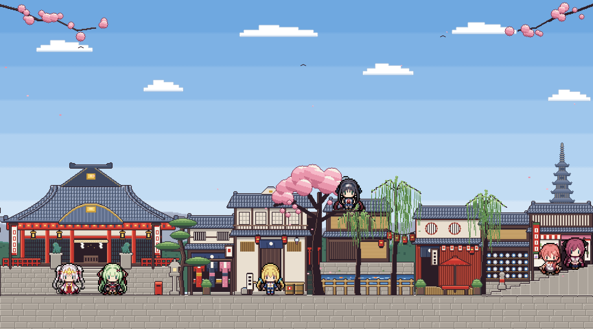
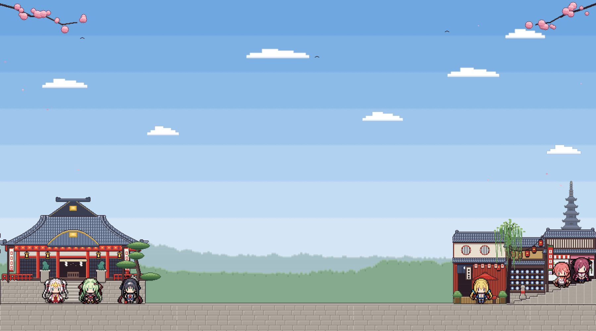

# senren-banka 千戀萬花・京都小鎮

Claude 桌面版的主題外掛：把對話背景換成一張白天的京都小鎮像素畫，風格參考《千戀萬花》。有完整版與兩側版兩種畫面，柳樹會輕輕搖、燈籠會輕輕晃。

## 示意圖

**完整版**（`/senren-banka`）



**兩側版**（`/senren-banka side`）：建築和角色只在左右兩側，中間留給聊天文字。



**六位角色**


## 安裝

在 Claude Code 的終端機輸入：

```
/plugin install senren-banka --marketplace maxx541/senren-banka-theme
```

按 `y` 加入來源，再選安裝範圍（建議第一個，使用者範圍）。

從一般終端機安裝：

```bash
claude plugin install senren-banka --marketplace maxx541/senren-banka-theme
```

桌面版不能輸入 `/plugin`：點提示框旁的「＋」→ Plugins → Add marketplace，填 `maxx541/senren-banka-theme`，再 Add plugin。

## 使用

- `/senren-banka`：完整版（神社、白川筋、祇園、二年坂）。
- `/senren-banka side`：兩側版。
- `/senren-banka image`：改用一張靜態圖片。
- `/senren-banka off`：關閉背景。

安裝後新開的工作階段會自動套用完整版。

## 注意

- 只有 **Claude 桌面版** 會畫背景；終端機與編輯器不會。
- 若有人看到「已套用」卻沒有畫面，常見原因是這個工作階段沒有桌面視窗連線，或 SVG 超過實測的大小上限（約 124K 字元以內才會畫）。
- 系統設定「減少動態效果」開啟時，動畫會自動停止。
- 背景是純向量 SVG（沒有點陣圖），完整版約 110K 字元、兩側版約 95K 字元。

## 版權

《千戀＊萬花》的角色、世界觀，以及這個外掛裡的像素畫作品，著作權皆屬 Yuzusoft 所有。這個外掛只是粉絲自製的非商業用途作品，不主張任何權利。
